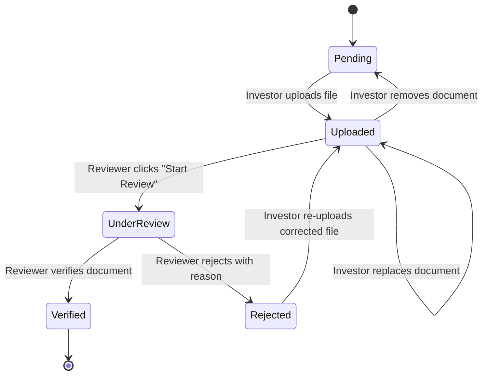

# APPLEN SOLUTIONS – DJ Investor Portal
## Investor Document Management System

A production-grade, responsive, frontend-only Investor Document Management System built with **React.js**, **Vite**, **JavaScript (ES6+)**, and custom **CSS3**.

The application streamlines compliance document workflows between **Investors** and **Compliance Reviewers** with real-time status transitions, client-side validation, document previewing, rejection resolution, and live statistical metrics.

---

## 1. Technology Stack

- **Framework**: React.js 19
- **Build Tooling**: Vite 8
- **Language**: JavaScript (ES6+ Modules)
- **Styling**: Pure CSS3 with modular component/page sheets and App.css global reset
- **State Management**: React Hooks (`useState`, `useMemo`, `useCallback`, `useRef`, `useEffect`)
- **Icons**: React Icons (`react-icons/fi`)
- **Client Storage & Memory**: Object URL (`URL.createObjectURL` & `URL.revokeObjectURL`) memory-leak safe management

---

## 2. Project Architecture & Folder Structure

```
src/
│
├── Components/
│   ├── Navbar.jsx                # Top bar with role toggle & reset
│   ├── Dashboard.jsx             # Top summary metrics & compliance progress
│   ├── DocumentChecklist.jsx     # Categorized document checklist
│   ├── DocumentCard.jsx          # Document item card with contextual actions
│   ├── UploadControl.jsx         # Drag & drop upload with simulated progress
│   ├── ReviewPanel.jsx           # Rejection workflow modal with reason templates
│   ├── StatusBadge.jsx           # Color-coded status badge with status icon
│   ├── SearchBar.jsx             # Title & filename search bar with clear button
│   ├── FilterPanel.jsx           # Category and status multi-filtering toolbar
│   └── ConfirmModal.jsx          # Accessible confirmation dialog
│
├── Pages/
│   ├── InvestorDashboard.jsx     # Investor workspace (upload, replace, preview)
│   └── ReviewerDashboard.jsx     # Reviewer workspace (review queue, verify, reject)
│
├── Data/
│   └── mockDocuments.js          # 8 demo documents with preloaded SVG previews
│
├── Hooks/
│   ├── useDocuments.js           # Document collection state & lifecycle transitions
│   └── useObjectUrl.js           # URL.createObjectURL lifecycle & cleanup hook
│
├── Utils/
│   ├── fileValidation.js         # Allowed types, 5MB limit, format helpers
│   └── documentHelpers.js        # Date formatters, filter logic, statistics
│
├── Styles/
│   ├── Components/
│   │   ├── navbar.css
│   │   ├── dashboard.css
│   │   ├── documentChecklist.css
│   │   ├── documentCard.css
│   │   ├── uploadControl.css
│   │   ├── reviewPanel.css
│   │   ├── statusBadge.css
│   │   ├── searchBar.css
│   │   ├── filterPanel.css
│   │   └── confirmModal.css
│   │
│   └── Pages/
│       ├── investorDashboard.css
│       └── reviewerDashboard.css
│
├── App.jsx                       # Root application component & layout shell
├── App.css                       # Global styles, CSS reset, body styles
└── main.jsx                      # Application entry point
```

---

## 3. Workflow & Lifecycle

The system operates across two core modes with strict lifecycle transitions:

### Mode 1: Investor Mode
1. **Pending**: Investors see guidance and click **Upload Document**.
2. **Uploading**: Drag & drop or select file (PDF, JPG, JPEG, PNG, max 5MB). Simulated upload progress animates from 0% to 100%.
3. **Uploaded**: Investors can **Preview** the document, **Replace** it with an updated file, or **Remove** it (with confirmation modal).
4. **Under Review**: Document is locked for edits while compliance officers inspect it.
5. **Verified**: Document receives a green verification badge and compliance completion increases.
6. **Rejected**: Rejection banner displays the reviewer's exact feedback. Investor can click **Re-upload Corrected File**, resetting status back to **Uploaded**.

### Mode 2: Reviewer Mode
1. **Queue Inspection**: Highlights documents in **Uploaded** and **Under Review** statuses.
2. **Start Review**: Moves document from `Uploaded` → `Under Review`.
3. **Verification**: Moves document from `Under Review` → `Verified`.
4. **Rejection**: Requires selecting a pre-formatted reason template or entering a custom rejection note (`Under Review` → `Rejected`).



---

## 4. Setup and Installation

### Prerequisites
- Node.js (v18.0.0 or higher recommended)
- npm or yarn

### Installation Steps

1. Clone or open the project directory:
   ```bash
   cd "I-D"
   ```

2. Install dependencies:
   ```bash
   npm install
   ```

3. Start the Vite development server:
   ```bash
   npm run dev
   ```

4. Open your browser and navigate to the local server URL (typically `http://localhost:5173`).

5. Build for production:
   ```bash
   npm run build
   ```

6. Run the linter:
   ```bash
   npm run lint
   ```

---

## 5. Security & Validation Rules

- **Allowed Formats**: `.pdf`, `.jpg`, `.jpeg`, `.png`
- **Maximum File Size**: 5 MB (`5,242,880` bytes)
- **Validation Handling**: Immediate field-specific error banners preventing invalid file uploads
- **Memory Safety**: `URL.revokeObjectURL()` called when files are replaced, removed, or unmounted
- **Data Immortality**: Includes a **Reset Data** button in the navbar to reset to the initial 8 mock documents at any point.
